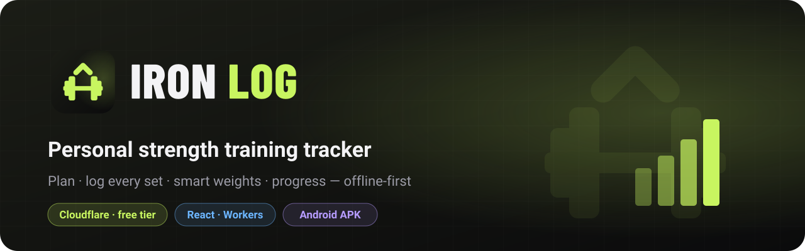
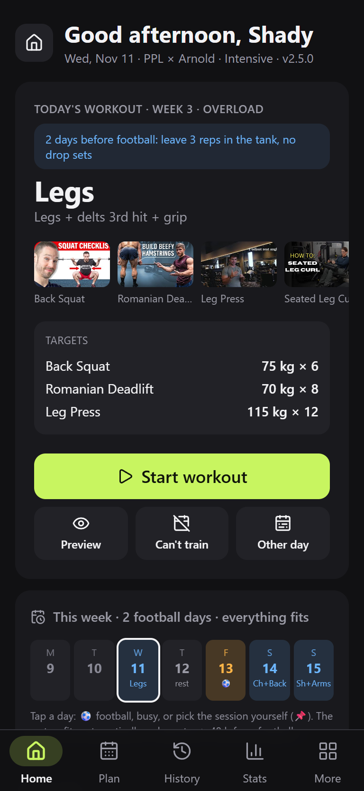
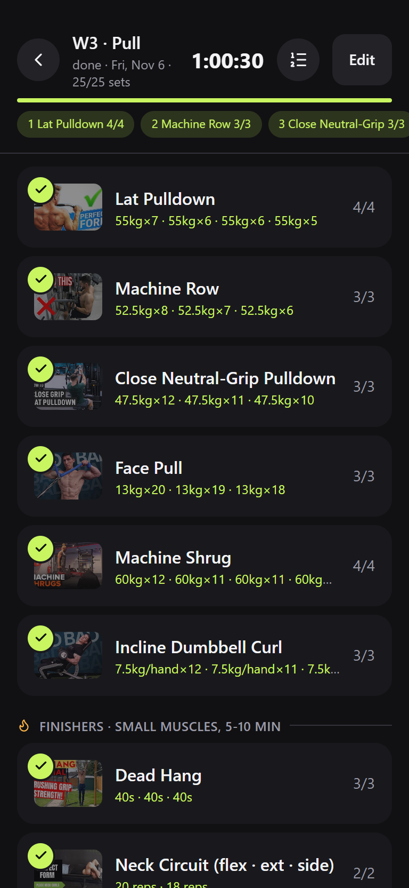
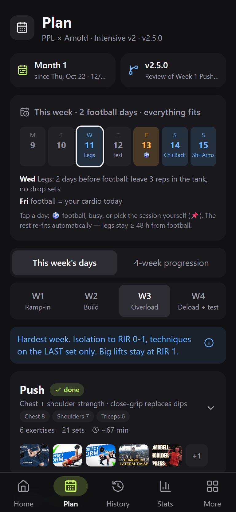
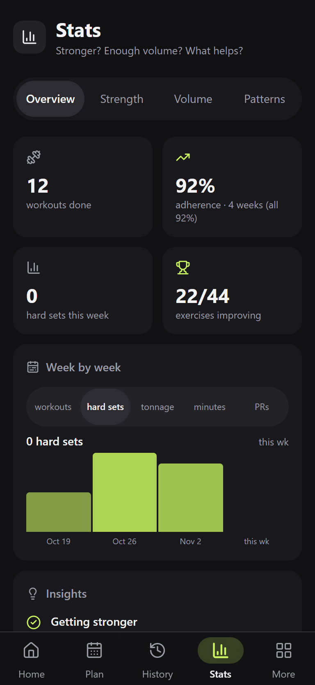
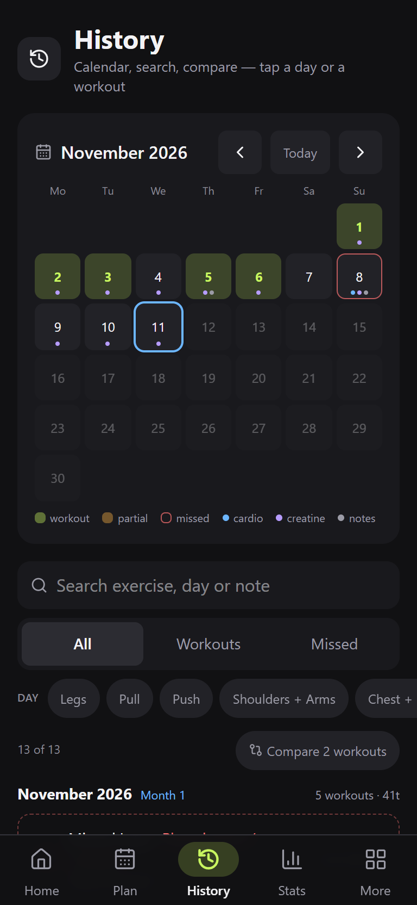
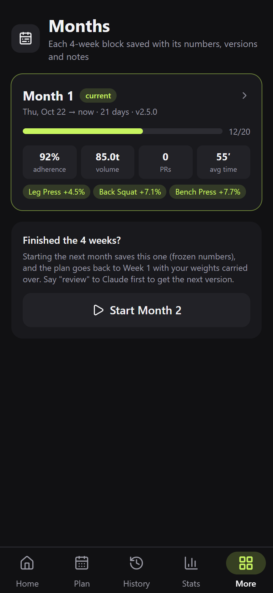
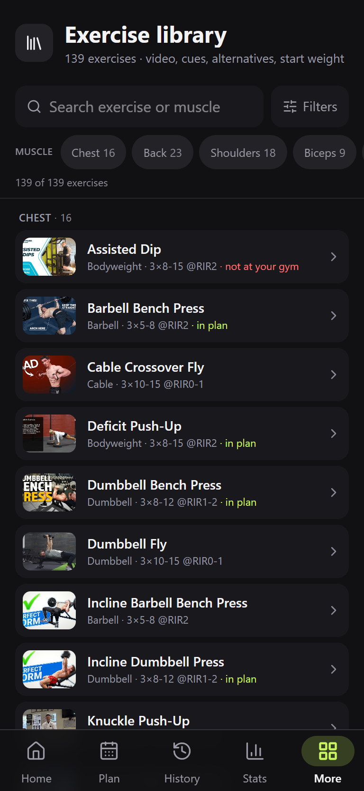
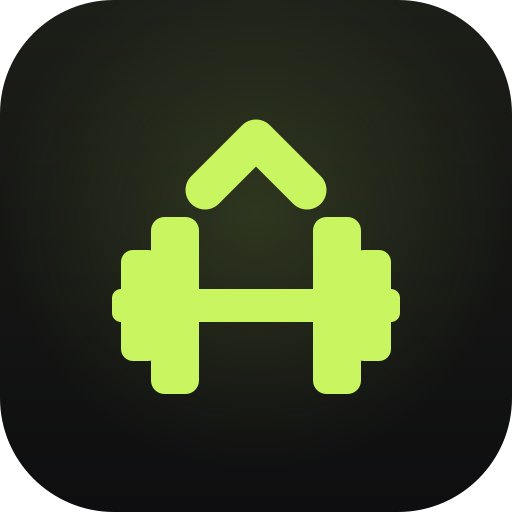

<p align="center"></p>

<p align="center">
  <a href="https://github.com/workingshady/iron-log/releases/latest"></a>
  
  
  
</p>

A personal, mobile-first strength training tracker built on **Cloudflare Workers + D1 + React**, all on the free tier.
The training program is plain, versioned data. Every set, rest, note and tap is logged, and after each session Claude reviews the data and writes the next plan version.

<p align="center">
  
  
  
  
</p>
<p align="center">
  
  
  
</p>

<sub>Screenshots use the built-in DEV mode (dummy data), on a Galaxy A24-sized screen.</sub>

## Features

| | |
|---|---|
| **Train** | One-tap set logging with RIR, cheat/strict flag, notes (voice: Arabic + English + mixed), pain area · supersets with round tracking · drop-set planner · rest timer (auto-start, sound, vibration, per-exercise rest) · plate loader with a realistic bar · warm-up ramps · workout preview |
| **Smart weights** | Double progression + RIR + est. max (Epley), deload weeks, rep-range aware, swap conversions between any two exercises · projected weights for all 4 weeks |
| **Plan** | PPL × Arnold program as data · football/busy-aware week planner with pins · 4-week progression view · 100+ exercise library with videos, cues, alternatives (reason-aware: pain, busy, too hard) |
| **Track** | Months (4-week blocks) with frozen summaries · plan version history with *why* · History calendar, search, compare two workouts · Stats (strength trends, hard sets per muscle, patterns) · body, creatine heatmap, cardio, tests, journal with mood |
| **Data** | Offline-first outbox · every tap in `events` · DEV mode with a separate database · export for review · additive migrations only |
| **App** | Installable PWA + signed Android APK (Trusted Web Activity) · dark UI, ≥44 px targets, WCAG AA contrast, screen-reader labels |

**Using it:** [docs/GUIDE.md](docs/GUIDE.md) · **Review workflow with Claude:** [CLAUDE.md](CLAUDE.md) · **Plan history:** [program/CHANGELOG.md](program/CHANGELOG.md)

## Android app
Download the APK from the **[latest release](https://github.com/workingshady/iron-log/releases/latest)**, open it on the phone, and allow "install unknown apps" once.
It opens the live site full-screen (Trusted Web Activity), so every deploy updates the app. A new APK is only needed when the icon, name or package changes.

```bash
node scripts/build-apk.mjs <versionCode> <versionName>     # e.g. 3 1.2.0 → private/android/out/iron-log-1.2.0.apk
gh release create v1.2.0-android private/android/out/iron-log-1.2.0.apk --title "Iron Log Android 1.2.0"
```
Always raise `versionCode` and sign with the same key (kept in git-ignored `private/android/`). `/.well-known/assetlinks.json` holds the key's SHA-256.

## Setup
```bash
npm install
cp .dev.vars.example .dev.vars          # local passcode
npm run db:migrate                      # local D1
npm run dev                             # http://localhost:5173
```

Deploy (Cloudflare account + `npx wrangler login`):
```bash
npx wrangler d1 create iron-log         # id goes in wrangler.jsonc
npm run db:migrate:remote
npx wrangler secret put APP_PASSCODE    # login passcode (DEV_PASSCODE for test mode)
npm run deploy
```

## Edit the plan
| Want to… | Do this |
|---|---|
| Change sets / reps / rest | the current file in `program/versions/` |
| Add an exercise | a block in `program/exercises.ts` (+ `groups.ts`, `muscles.ts`, `starters.ts`) |
| Add an alternative | its key in `alts` + an optional conversion in `program/swaps.ts` |
| New version | bump `version`, add an entry to `program/history.ts` and `program/CHANGELOG.md` |
| Excuses / pain areas / tags | `shared/lists.ts` |

Then: `npm run check && npm run deploy`.

## Layout
```
program/     plan as data: exercises, versions, swaps, history, learn
shared/      types + logic shared by API and UI (recommend, weekplan, project, load)
worker/      Cloudflare Worker API (Hono) + D1 schema (Drizzle) + analytics
src/         React UI: screens/, components/, lib/
migrations/  SQL migrations (additive)
scripts/     export, checks, APK build, analysis helpers
public/      icons, brand SVGs, manifest, service worker
private/     git-ignored: exports, backups, signing key, notes
```

## Brand
 &nbsp; App icon, maskable and themed (monochrome) icons, and logos for dark and light backgrounds are in [`public/`](public/) and [`public/brand/`](public/brand/).
